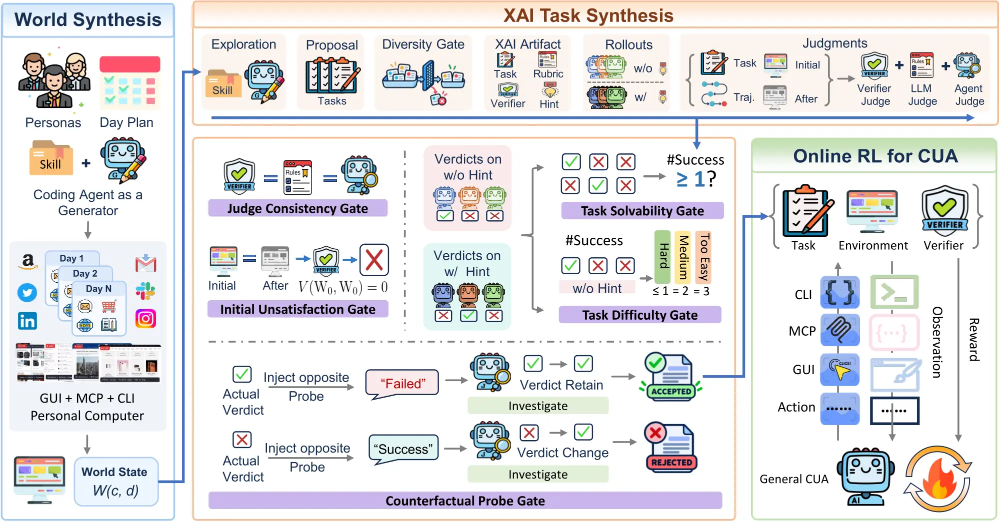

<h1 align="center"> Agent World Model in the Wild</h1>

<h2 align="center">Computer-Use Agent Environment Synthesis</h2>


<p align="center">
  <a href="https://arxiv.org/abs/2610.26828"></a>
  <a href="https://msr-orchard.github.io/WildAWM/"></a>
  <a href="https://github.com/MSR-Orchard/WildAWM"></a>
  <a href="https://huggingface.co/collections/ChilleD/agent-world-model-in-the-wild"></a>
  <a href="https://huggingface.co/datasets/ChilleD/WildAWM"></a>
  <a href="https://huggingface.co/ChilleD/WildAWM-35B-A3B"></a>
  <a href="https://huggingface.co/ChilleD/WildAWM-4B"></a>
</p>

<p align="left">
  <b>Agent World Model in the Wild (WildAWM)</b> synthesizes executable personal-computer worlds and grounded cross-interface (XAI) tasks for general computer-use agents. Each world combines local files and command-line workflows, MCP services, and mirrored websites with graphical interfaces from <a href="https://github.com/aiming-lab/WebHarbor">WebHarbor</a>, and evolves day by day from a persona. Each task is validated for solvability, difficulty, and verifier reliability through ensemble execution. <b>The entire pipeline is powered by open-source LLMs, without any proprietary models</b>. 
</p>

<p align="center">
  
</p>

---

## 📣 News

- **Oct 19, 2026** 📢 WildAWM paper, code, environments and tasks, and trained checkpoints released.

## 🔮 Resources

| Resource | Link |
|---|---|
| 📄 Paper | [arXiv: 2610.26828](https://arxiv.org/abs/2610.26828) |
| 🌐 Project page | [msr-orchard.github.io/WildAWM](https://msr-orchard.github.io/WildAWM/) |
| 💻 Code | [MSR-Orchard/WildAWM](https://github.com/MSR-Orchard/WildAWM) |
| 🤗 Data and models | [Hugging Face collection](https://huggingface.co/collections/ChilleD/agent-world-model-in-the-wild) |
| 📦 341 environment-task pairs | [ChilleD/WildAWM](https://huggingface.co/datasets/ChilleD/WildAWM) |
| 🧭 Harbor hub | [wildawm](https://hub.harborframework.com/datasets/wildawm) |
| 🤖 WildAWM-35B-A3B | [ChilleD/WildAWM-35B-A3B](https://huggingface.co/ChilleD/WildAWM-35B-A3B) |
| 🤖 WildAWM-4B | [ChilleD/WildAWM-4B](https://huggingface.co/ChilleD/WildAWM-4B) |

## 📦 Installation

Requires Python 3.12+, [uv](https://docs.astral.sh/uv/), Docker, and Node.js. One `uv sync` installs both synthesis and evaluation, and all commands below run from the repository root.

```bash
git clone https://github.com/MSR-Orchard/WildAWM.git && cd WildAWM
uv sync
uv run wildawm --help
```

## 🔥 Synthesis

Synthesis has two stages. **World synthesis** builds cumulative personal-computer states $W(c,d)$ from a persona $c$ and a day $d$. **XAI task synthesis** explores these states, authors tasks and verifiers, collects heterogeneous agent rollouts, and applies five quality gates. Accepted `{task, environment, verifier}` triplets support supervised fine-tuning, online reinforcement learning, and evaluation.

To directly use the released 341 environment-task pairs instead, download them and go straight to evaluation:

```bash
uv run hf download ChilleD/WildAWM --repo-type dataset --local-dir data/wildawm-harbor
```

### Setup

Copy the two configuration files, fill in your endpoints, keys, and model refs, and export `.env` into the shell that runs synthesis commands:

```bash
cp synthesis/.env.example synthesis/.env
cp synthesis/models.example.json synthesis/models.json
set -a; source synthesis/.env; set +a
```

Build the runtime images, then copy the pristine seeds of the 15 WebHarbor website mirrors from the pinned WebHarbor image (once per data root):

```bash
docker build -f synthesis/docker/Dockerfile.creator -t wildawm-creator:latest synthesis
docker build -f synthesis/docker/Dockerfile.agent -t wildawm-agent:latest synthesis
docker build -f synthesis/docker/Dockerfile.mcp -t wildawm-mcp:worlds -t wildawm-mcp:latest synthesis
docker build -f synthesis/docker/Dockerfile.webharbor -t wildawm-webharbor:latest synthesis
docker build -f synthesis/docker/Dockerfile.worldctl -t wildawm-worldctl:latest synthesis
uv run python -m wildawm.webharbor.lib populate
```

<details>
<summary>Main settings in <code>synthesis/.env</code> and <code>synthesis/models.json</code></summary>

| Setting | Purpose |
|---|---|
| `models.json` | Providers, endpoints, keys, model ids, context windows, and reasoning-effort support. Models are referenced as `provider/model`. |
| `WILDAWM_SYNTH_MODEL_REF` | Default generator and judge model. |
| `WILDAWM_VISION_BASE_URL`, `_API_KEY`, `_MODEL` | Vision model behind `describe_image` for text-only synthesis models. |
| `WILDAWM_ENSEMBLE_MODELS`, `WILDAWM_ENSEMBLE_HARNESSES` | Model × harness pool for the XAI rollout gates. Harnesses: `opencode`, `codex`, `claude-code`, `nanobot`, `openclaw`, `hermes`. |
| `WILDAWM_DATA_ROOT` | Optional. Moves generated worlds, tasks, outputs, and logs out of `synthesis/`. |
| `WILDAWM_SYNTHESIS_CONFIG` | Optional. Points at a copy of `synthesis/configs/synthesis.example.jsonc` with iteration limits and quality-gate settings. |

</details>

### Stage 1: World synthesis

A world is the cumulative state of one persona's computer: local files, MCP application databases, WebHarbor state, and optional per-world code overlays. Days are strictly serial, because day $d$ starts from the materialized state of day $d-1$.

```bash
uv run wildawm syn profile --name "Riley Nguyen"              # logs the new profile id
uv run wildawm syn world --profile <profile-id> --to_day 14   # plan, implement, and pre-bake days 0..14
```

<details>
<summary>Run the three per-day steps separately</summary>

1. **Day planning** reads the persona, prior plans, the real day $d-1$ state, application coverage, and the shared event-skill and MCP-application libraries. It writes the day plan and a machine-readable mapping of each activity to its skill, interfaces, and artifacts.

   ```bash
   uv run wildawm syn dayplan --profile <profile-id> --day 0
   ```

2. **Day implementation** starts from the real day $d-1$ state and writes a deterministic, offline replay program.

   ```bash
   uv run wildawm syn dayimpl --profile <profile-id> --day 0
   ```

3. **Pre-baking** materializes $W(c,d)$ so task synthesis and evaluation can create isolated instances without replaying earlier days. `--verify_rebake yes` rebuilds the chain from `delta.sh` and compares it with the pre-baked snapshots.

   ```bash
   uv run wildawm syn prebake --profile <profile-id> --to_day 0 --verify_rebake yes
   ```

</details>

### Stage 2: XAI task synthesis

Task synthesis provisions isolated generator, rollout, and judge worlds through the dashboard, so start it first in its own terminal:

```bash
uv run wildawm dashboard                                # http://localhost:8624
uv run wildawm syn task --profile <profile-id> --day 5
```

For each day, the pipeline drafts task sketches from real files, MCP records, and WebHarbor state, selects diverse tasks, and writes each task with its verifier. It then checks that the verifier fails on the clean state and passes on the golden state, collects heterogeneous agent rollouts and judgments, and applies the five quality gates with iterative refinement.

<details>
<summary>Synthesize tasks for several days in parallel</summary>

```bash
uv run wildawm syn task --profile <profile-id> --days 3,5,7 --difficulty hard,hard,medium --count 3 --parallel 3
```

Each day gets `--count` tasks whose difficulties cycle through `--difficulty` (here two hard and one medium), and `--parallel` days run at once.

</details>

### Run and verify a task

With the dashboard running, list what you have built, then create a disposable world from a day snapshot and run an agent on a task:

```bash
uv run wildawm view world
uv run wildawm view task
uv run wildawm world create --profile <profile-id> --day 5 --harness opencode --llm provider/model --task <task-id> --episode yes
```

`--episode yes` archives the trajectory with before/after world snapshots, runs the verifier, and destroys the world. Re-verify an archived run (the folder that `world create` logs) offline; `--mode heavy` runs a separate agent-as-a-judge that inspects the worlds:

```bash
uv run wildawm verify --dir <run-dir>
uv run wildawm verify --dir <run-dir> --mode heavy
```

### Export to Harbor

Export accepted triplets as Harbor task packages. Each package embeds a pinned Node.js runtime, which you download once:

```bash
curl -fLO https://nodejs.org/dist/v22.23.2/node-v22.23.2-linux-x64.tar.xz
uv run wildawm syn export-harbor --node_archive node-v22.23.2-linux-x64.tar.xz --out_dir outputs/wildawm-harbor
```

To evaluate the exported packages, add `--set benchmark.dataset_dir=outputs/wildawm-harbor,benchmark.subset=all` to `wildawm eval run --benchmark wildawm`.

## ⚖️ Evaluation

Every benchmark runs the same [OpenCode](https://opencode.ai) harness equipped with GUI, MCP, and shell tools. Tasks run in local Docker containers. Benchmark credits go to their respective authors. 

| Benchmark | `--benchmark` | Tasks | Metric | Environment |
|---|---|---|---|---|
| Online-Mind2Web | `online_mind2web` | 300 | pass rate (LLM judge) | live websites, local browser |
| WebArena | `webarena` | 226 | pass rate | self-hosted WebArena sites |
| QwenClawBench | `qwenclawbench` | 100 | mean score | sandbox |
| ClawEval | `claweval` | 300 | pass rate (score ≥ 0.75) | sandbox |
| CUA-Gym | `cua_gym` | 200 | mean score | sandbox |
| OSWorld-Verified | `osworld_verified` | 99 | mean score | sandbox |
| OSWorld 2.0 | `osworld2` | 108 | mean score | sandbox |
| Agents' Last Exam | `ale` | 99 | mean score | sandbox |
| WildAWM | `wildawm` | 341 (val: 33) | pass@k / pass^k | sandbox (Harbor) |

### Setup

Install the pinned OpenCode runtime (OpenCode 1.17.7, its plugin runtime, and Playwright MCP under `evaluation/runtime/opencode`) and the host Chromium used by `online_mind2web` and `webarena`, then create `config.yaml`:

```bash
./evaluation/scripts/setup_opencode.sh
uv run playwright install chromium
cp evaluation/config.example.yaml config.yaml
```

`config.yaml` sets the tested model (`agent`), the vision model behind `vision_describe_image` (`vision`), the LLM judge (`judge`), harness limits (`opencode`), the sandbox backend and resources (`sandbox`), concurrency and timeouts (`run`), and per-benchmark data paths and overrides (`benchmarks`). 

Download the benchmark data. Gated datasets need a Hugging Face token (`uv run hf auth login`, `HF_TOKEN`, or `benchmarks.<name>.hf_token`):

```bash
uv run wildawm eval list
uv run wildawm eval prepare --benchmark osworld2
uv run hf download ChilleD/WildAWM --repo-type dataset --local-dir data/wildawm-harbor
uv run wildawm eval prepare --benchmark wildawm
```

Then choose where the task sandboxes run.

#### Local Docker

The default (`sandbox.backend: docker`): each task runs in a container on the local Docker daemon. Containers reach loopback model endpoints through `host.docker.internal`.

#### Orchard

[Orchard](https://github.com/microsoft/Orchard-Agentic) runs each task as a pod on a Kubernetes cluster behind a Modal-style sandbox API. Point `config.yaml` at its orchestrator:

```yaml
sandbox:
  backend: orchard                      # official client: uv sync --extra orchard
  orchard: {base_url: https://<orchestrator>, api_key: <key>, create_timeout: 1800}
```

You can set `backend: modal` to use the same API through a built-in client with no extra install (`sandbox.modal.base_url` and `api_key`). Note that `online_mind2web` and `webarena` always run locally.

### Run

```bash
uv run wildawm eval run --benchmark cua_gym --limit 2                         # smoke test
uv run wildawm eval run --benchmark cua_gym --name my-run                     # full run; reuse --name to resume
uv run wildawm eval run --benchmark osworld2 --set agent.model=my-model --tasks 052,070
uv run wildawm eval score --run_dir outputs/cua_gym/my-run                    # recompute summary.json
```

Each run writes `outputs/<benchmark>/<name>/` with the resolved `config.yaml`, `results.jsonl` (one row per trial), `summary.json`, and per-task artifacts (OpenCode events, model-call log, evaluator output). 

## Citation

If you find this work useful, please kindly cite:

```bibtex
@article{wang2026agentworldmodelwild,
  title={Agent World Model in the Wild: Computer-Use Agent Environment Synthesis},
  author={Zhaoyang Wang and Qianhui Wu and Haorui Wang and Simon Yu and Baolin Peng and Canwen Xu and Hao Cheng and Wenlin Yao and Boyi Liu and Yite Wang and Jianfeng Gao and Huaxiu Yao},
  year={2026},
  eprint={2610.26828},
  archivePrefix={arXiv},
  primaryClass={cs.AI},
  url={https://arxiv.org/abs/2610.26828},
}
```
